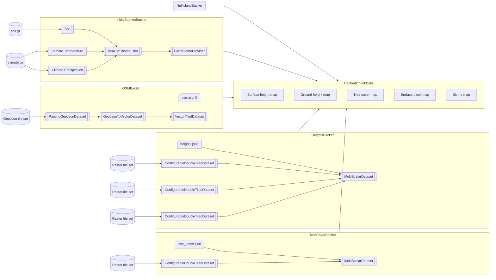

The world generation module provides the world generation pipeline.

The pipeline is composed of `IEarthDataBacker` implementations that can fetch data from datasets,
project it into the world's coordinate system, and write processed data onto `CachedChunkData` instances.

The datasets can be embedded into the JARs if small enough, but are mostly fetched in small pieces (tiles)
from remote sources via Terracore's HTTP client or read from disk.
They can be raster datasets of integers or double floating points, or vector dataset (collections of geometric shapes),
and may be loaded from many file types (PNG, TIFF, GeoJSON, etc.).

The default pipeline is the following:

